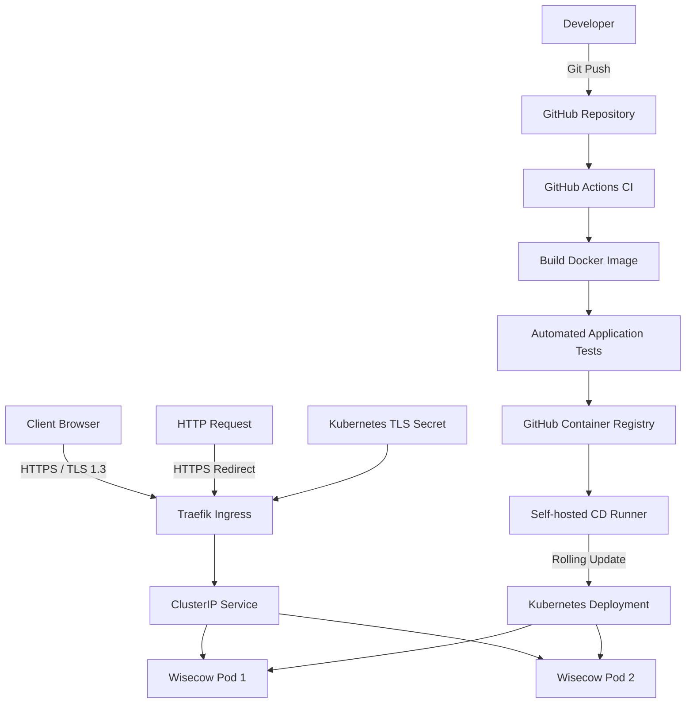

# AccuKnox DevOps Assessment


## Overview

This repository contains my implementation of the AccuKnox
DevOps assessment, covering application containerization,
Kubernetes orchestration, CI/CD automation, secure TLS
communication and infrastructure monitoring.

The Wisecow application has been enhanced to address
connection-handling issues observed during Kubernetes
deployment and health probe testing.

## Technology Stack

| Component | Technology |
|---|---|
| Operating System | Ubuntu 26.04 on WSL2 |
| Containerization | Docker |
| Container Runtime | containerd |
| Orchestration | Kubernetes / Minikube |
| CI/CD | GitHub Actions |
| Container Registry | GitHub Container Registry |
| Ingress Controller | Traefik |
| TLS | OpenSSL / TLS 1.3 |
| Application | Bash, Socat, Fortune, Cowsay |
| Monitoring | Python, psutil, urllib |
| Version Control | Git and GitHub |

---

# Problem Statement 1

## Architecture



## Key Features

- Lightweight Docker image using Debian slim.
- Non-root container execution.
- Kubernetes Deployment with two replicas.
- CPU and memory requests and limits.
- Readiness and liveness probes.
- Rolling deployment strategy.
- Kubernetes pod-level self-healing.
- Automated Docker image building and testing.
- Private container registry integration.
- Automated Kubernetes deployment demonstration.
- TLS termination using Traefik.
- HTTP-to-HTTPS redirection.
- Configurable Python monitoring tools.

## Repository Structure

```text
.
├── .github/
│   └── workflows/
│       └── ci-cd.yaml
├── k8s/
│   ├── deployment.yaml
│   ├── service.yaml
│   ├── ingress.yaml
│   └── https-redirect.yaml
├── scripts/
│   ├── system_health_monitor.py
│   ├── application_health_checker.py
│   └── requirements.txt
├── .dockerignore
├── .gitignore
├── Dockerfile
├── LICENSE
├── README.md
└── wisecow.sh
```

Certificates, private keys, virtual environments and
generated monitoring logs are excluded from version control.

## Prerequisites

- Linux or WSL2
- Docker Engine
- kubectl
- Minikube
- Git
- GitHub CLI
- OpenSSL
- Python 3

## 1. Clone the Repository

```bash
git clone https://github.com/Farooq710/accuknox-wisecow-assessment.git
cd accuknox-wisecow-assessment
```

Repository access is required because the repository is private.

## 2. Build and Run the Docker Container

```bash
docker build -t wisecow:v1.0.1 .

docker run -d \
  --name wisecow-container \
  -p 127.0.0.1:4499:4499 \
  wisecow:v1.0.1
```

Access the application:

http://localhost:4499

Verify application health:

```bash
curl -i http://localhost:4499/healthz
```

Verify non-root execution:

```bash
docker exec wisecow-container id
```

The application runs with UID and GID 10001.

## 3. Kubernetes Deployment

Start Minikube:

```bash
minikube start \
  --driver=docker \
  --cpus=2 \
  --memory=3072 \
  --container-runtime=containerd
```

### Private Registry Authentication

The published image is hosted at:

```text
ghcr.io/farooq710/accuknox-wisecow-assessment
```

Authenticate using a GitHub credential authorized to read
the private container package.

```bash
gh auth login
gh auth refresh -h github.com -s read:packages
```

Create an isolated Docker authentication configuration:

```bash
REGISTRY_CONFIG=$(mktemp -d)

gh auth token | docker --config "$REGISTRY_CONFIG" \
  login ghcr.io -u YOUR_GITHUB_USERNAME --password-stdin

kubectl create secret generic ghcr-secret \
  --from-file=.dockerconfigjson="$REGISTRY_CONFIG/config.json" \
  --type=kubernetes.io/dockerconfigjson \
  --dry-run=client -o yaml | kubectl apply -f -

rm -rf "$REGISTRY_CONFIG"
```

The authenticated account must have access to the package.
A dedicated read-only package credential is preferable
for production deployments.

Deploy the application:

```bash
kubectl apply -f k8s/deployment.yaml
kubectl apply -f k8s/service.yaml

kubectl rollout status deployment/wisecow-deployment
kubectl get deployments
kubectl get pods -o wide
kubectl get svc
```

### Alternative: Local Image Deployment

If private registry access is unavailable, build and load
the local image into Minikube:

```bash
docker build -t wisecow:v1.0.1 .
minikube image load wisecow:v1.0.1
```

Render a temporary manifest using the local image:

```bash
kubectl set image -f k8s/deployment.yaml \
  wisecow=wisecow:v1.0.1 \
  --local -o yaml |
kubectl patch --local -f - \
  --type=json \
  -p='[{"op":"remove","path":"/spec/template/spec/imagePullSecrets"}]' \
  -o yaml | kubectl apply -f -

kubectl apply -f k8s/service.yaml
```

### Application Access

```bash
kubectl port-forward svc/wisecow-service 8080:80
```

Open http://localhost:8080.

### Kubernetes Self-Healing

Delete one application pod:

```bash
kubectl delete pod $(kubectl get pods \
  -l app=wisecow \
  -o jsonpath='{.items[0].metadata.name}') \
  --wait=false

kubectl get pods -l app=wisecow -w
```

Kubernetes automatically creates a replacement pod
to maintain the desired replica count.

During testing, the replacement pod reached readiness
at approximately 10 seconds of pod age.

This demonstrates pod-level recovery, not node-level
high availability, as Minikube uses a single node.

## 4. Application Reliability Improvements

The original Wisecow application uses Netcat and a named
pipe to handle HTTP requests sequentially.

During Kubernetes testing, intermittent connection resets,
EOF errors and failed health probes were observed.

The application was enhanced by:

- Replacing Netcat with Socat.
- Supporting concurrent connections.
- Removing the named pipe dependency.
- Adding proper HTTP response headers.
- Adding Content-Length and Connection headers.
- Introducing a dedicated /healthz endpoint.
- Preserving the original Fortune and Cowsay functionality.

The updated application was successfully tested with
concurrent requests and Kubernetes health probes.

## 5. CI/CD Pipeline

The GitHub Actions workflow performs:

1. Source code checkout.
2. Bash syntax validation.
3. Docker image building.
4. Application readiness verification.
5. HTTP response testing.
6. Concurrent testing with 50 requests.
7. Non-root execution verification.
8. Container registry authentication.
9. Docker image publishing.
10. Conditional Kubernetes deployment.
11. Rolling update verification.
12. Application health verification.

Images are published using:

- latest
- Git commit SHA

The commit-specific image tag enables deployment
traceability and controlled rollbacks.

### Continuous Deployment

Continuous deployment was demonstrated using an ephemeral
self-hosted GitHub Actions runner connected to the local
Minikube cluster.

Runner labels:

```text
self-hosted, Linux, X64, wisecow-cd
```

The deployment job uses the exact image SHA generated by
the build job and verifies the Kubernetes rollout.

The runner was removed after the successful demonstration
to avoid exposing the personal development environment.

The repository variable ENABLE_CD controls deployment.

| Variable | Behaviour |
|---|---|
| false | Build, test and publish only |
| true | Enable deployment for eligible pushes |

To reproduce automated deployment, provision a trusted
runner with Kubernetes access, configure the registry
secret and enable the repository variable.

Do not enable a personal self-hosted runner in a repository
accessible to untrusted workflow authors.

## 6. Secure TLS Communication

Enable Traefik:

```bash
minikube addons enable traefik
```

Generate a self-signed certificate:

```bash
mkdir -p certs
chmod 700 certs

openssl req -x509 \
  -newkey rsa:2048 \
  -sha256 \
  -nodes \
  -keyout certs/tls.key \
  -out certs/tls.crt \
  -days 365 \
  -subj "/CN=wisecow.local" \
  -addext "subjectAltName=DNS:wisecow.local"

chmod 600 certs/tls.key
```

Create the Kubernetes TLS secret:

```bash
kubectl create secret tls wisecow-tls \
  --cert=certs/tls.crt \
  --key=certs/tls.key
```

Apply the Ingress resources:

```bash
kubectl apply -f k8s/ingress.yaml
kubectl apply -f k8s/https-redirect.yaml
```

Forward the HTTPS and HTTP ports using separate terminals:

```bash
kubectl port-forward -n kube-system svc/traefik 8443:443
```

```bash
kubectl port-forward -n kube-system svc/traefik 8081:80
```

Verify HTTPS with certificate validation:

```bash
curl -v \
  --cacert certs/tls.crt \
  --resolve wisecow.local:8443:127.0.0.1 \
  https://wisecow.local:8443/
```

Verify HTTP-to-HTTPS redirection:

```bash
curl -I \
  --resolve wisecow.local:8081:127.0.0.1 \
  http://wisecow.local:8081/
```

For browser access, configure the local hosts file:

```text
127.0.0.1 wisecow.local
```

Access:

https://wisecow.local:8443/

For local browser testing, the generated public certificate
can be explicitly trusted by the operating system.

Remove the certificate from the trust store after testing.

### TLS Verification Results

| Parameter | Result |
|---|---|
| TLS Protocol | TLS 1.3 |
| HTTP Protocol | HTTP/2 |
| Cipher Suite | TLS_AES_128_GCM_SHA256 |
| Certificate Hostname | wisecow.local |
| HTTP Status | 200 OK |
| Certificate Verification | Successful |
| HTTP-to-HTTPS Redirect | Successful |

TLS terminates at Traefik. Communication between Traefik
and the backend service uses internal HTTP.

The self-signed certificate and custom HTTPS port are
intended for local demonstration. Production deployments
should use a trusted certificate authority and standard
HTTPS port 443.

---

# Problem Statement 2

The following two automation tasks were selected:

1. System Health Monitoring.
2. Application Health Checker.

## Python Environment Setup

```bash
python3 -m venv .venv
source .venv/bin/activate

python -m pip install -r scripts/requirements.txt
```

## Task 1: System Health Monitoring

Script:

```text
scripts/system_health_monitor.py
```

### Features

- CPU utilization monitoring.
- Memory utilization monitoring.
- Disk utilization monitoring.
- Process count monitoring.
- Configurable thresholds.
- Memory-intensive process identification.
- Continuous and single-check execution.
- Timestamped console and rotating file logs.
- Graceful shutdown and exception handling.

### Default Thresholds

| Metric | Threshold |
|---|---|
| CPU | 80% |
| Memory | 80% |
| Disk | 80% |
| Process Count | 300 |
| Monitoring Interval | 10 seconds |

### Usage

Perform a single health check:

```bash
python scripts/system_health_monitor.py --once
```

Continuous monitoring:

```bash
python scripts/system_health_monitor.py --interval 5
```

Simulate threshold alerts:

```bash
python scripts/system_health_monitor.py \
  --cpu 0 \
  --memory 1 \
  --disk 1 \
  --processes 1 \
  --once
```

Log file:

```text
logs/system_health.log
```

### Observed Test Results

| Metric | Observed Value |
|---|---|
| CPU | 1.8% |
| Memory | 17.9% |
| Disk | 0.8% |
| Process Count | 87 |
| System Status | HEALTHY |

These values represent the Linux WSL environment at
the time of testing.

## Task 2: Application Health Checker

Script:

```text
scripts/application_health_checker.py
```

### Features

- HTTP and HTTPS application monitoring.
- Application UP/DOWN detection.
- HTTP status code verification.
- Response time measurement.
- Configurable timeout and monitoring interval.
- Slow-response warnings.
- TLS certificate verification.
- Connection and certificate error handling.
- Rotating logs.
- Non-zero exit status for failed single checks.

### Usage

Ensure the HTTPS port-forward is active and wisecow.local
resolves to 127.0.0.1 in the monitoring environment.

Single HTTPS health check:

```bash
python scripts/application_health_checker.py \
  --url https://wisecow.local:8443/healthz \
  --ca-cert certs/tls.crt \
  --once
```

Continuous monitoring:

```bash
python scripts/application_health_checker.py \
  --url https://wisecow.local:8443/healthz \
  --ca-cert certs/tls.crt \
  --interval 5
```

Simulate application unavailability using an unused port:

```bash
python scripts/application_health_checker.py \
  --url http://127.0.0.1:59999/healthz \
  --timeout 3 \
  --once
```

Simulate a slow-response warning:

```bash
python scripts/application_health_checker.py \
  --url https://wisecow.local:8443/healthz \
  --ca-cert certs/tls.crt \
  --response-threshold 1 \
  --once
```

Test certificate verification failure:

```bash
python scripts/application_health_checker.py \
  --url https://127.0.0.1:8443/healthz \
  --ca-cert certs/tls.crt \
  --once
```

Log file:

```text
logs/application_health.log
```

### Observed Test Results

| Test Scenario | Result |
|---|---|
| Application Availability | UP |
| HTTP Status Code | 200 |
| Initial Response Time | 27.60 ms |
| Minimum Observed Latency | 22.73 ms |
| Maximum Observed Latency | 41.29 ms |
| Connection Refused Detection | Passed |
| Slow-Response Alert | Passed |
| TLS Verification Failure Detection | Passed |
| Continuous Monitoring | Passed |
| Graceful Shutdown | Passed |
| Log Generation | Passed |

All displayed requests during the continuous monitoring
test returned HTTP 200.

---

## Security Considerations

- Non-root application containers.
- Disabled privilege escalation.
- Dropped Linux capabilities.
- RuntimeDefault seccomp profile.
- Disabled automatic service account token mounting.
- Private container registry.
- Kubernetes image pull secrets.
- TLS certificate verification.
- Restricted private key permissions.
- Secrets excluded from Git and Docker build context.
- Explicit GitHub Actions token permissions.
- Temporary ephemeral deployment runner.
- Rotating monitoring logs.

## Known Limitations

- The Kubernetes environment is a single-node local cluster.
- External application access uses port forwarding.
- TLS terminates at the Ingress controller.
- The TLS certificate is self-signed for local demonstration.
- Automated deployment requires an available trusted runner.
- Monitoring alerts are written to console and log files.
- The application health checker measures endpoint
  responsiveness rather than full business functionality.

## Implementation and Testing Evidence

The implementation was validated through practical deployment,
CI/CD execution, Kubernetes self-healing, TLS verification,
and system and application monitoring tests.

[View Implementation Screenshots and Testing Evidence](screenshots/README.md)

## Conclusion

This assessment demonstrates an end-to-end DevOps
implementation covering application containerization,
Kubernetes orchestration, CI/CD, registry integration,
application reliability, TLS security and automated
system and application monitoring.

The implementation was validated through practical
deployment, rolling update, self-healing, application
availability and failure-detection testing.

## Author

Farooq Khan

GitHub: https://github.com/Farooq710

## Attribution and License

The original Wisecow application is available at:

https://github.com/nyrahul/wisecow

The original project license is preserved in LICENSE.
This repository extends the original application for
the AccuKnox DevOps assessment.

