# Implementation and testing evidence

Selected screenshots from the actual local Wisecow assessment execution, 25–27 November 2026. These are historical test records, not a live service status report.

## Problem Statement 1 — Docker, Kubernetes, CI/CD and TLS

### Updated Docker container

Wisecow v1.0.1 running with local port 4500 mapped to container port 4499.

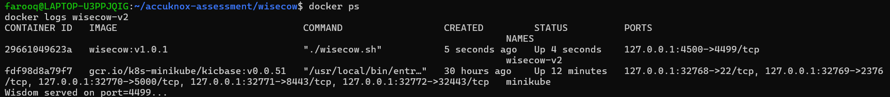

### Non-root execution

Earlier container test confirms UID and GID 10001 and a successful HTTP response.

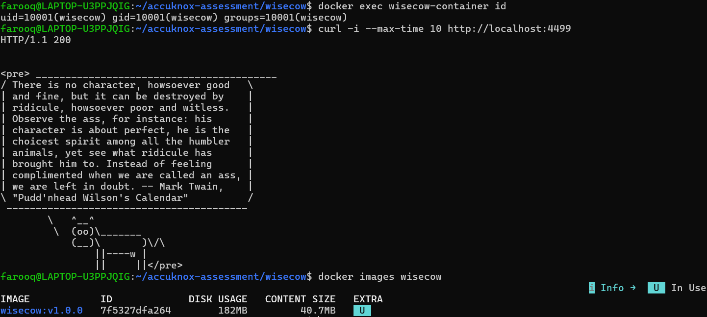

### Improved HTTP response

Updated application returns HTTP 200 OK with Content-Type, Content-Length and Connection headers.

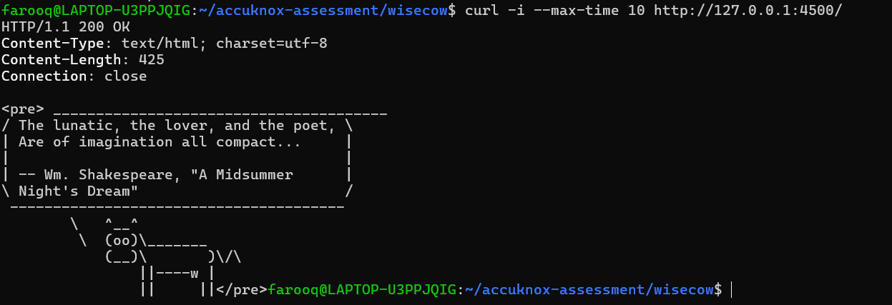

### Kubernetes rolling update

Two ready replicas, zero restarts in the displayed pods, and the previous ReplicaSet scaled down.

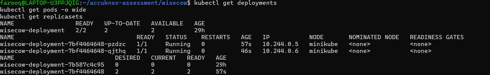

### Pod self-healing

Historical probe warnings from the older ReplicaSet are visible; the updated deployment replaces a deleted pod, which reaches readiness at 10 seconds of pod age.

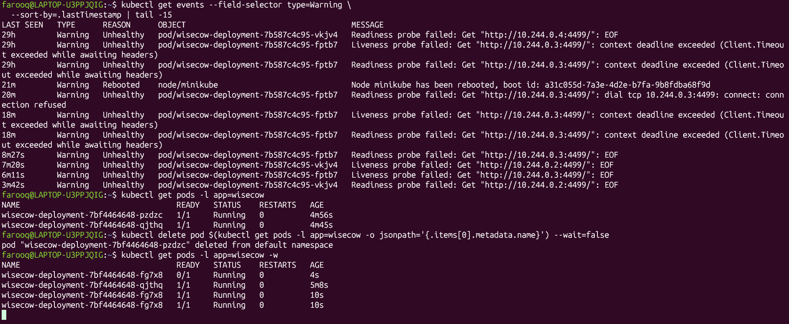

### Service endpoints after recovery

Two ready pods and both application service endpoints after the deletion test.

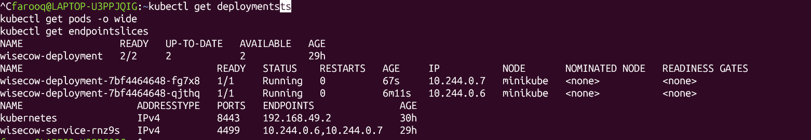

### Continuous integration

Successful build, test and publish workflow in 27 seconds. The historical action-runtime deprecation warning remains visible.

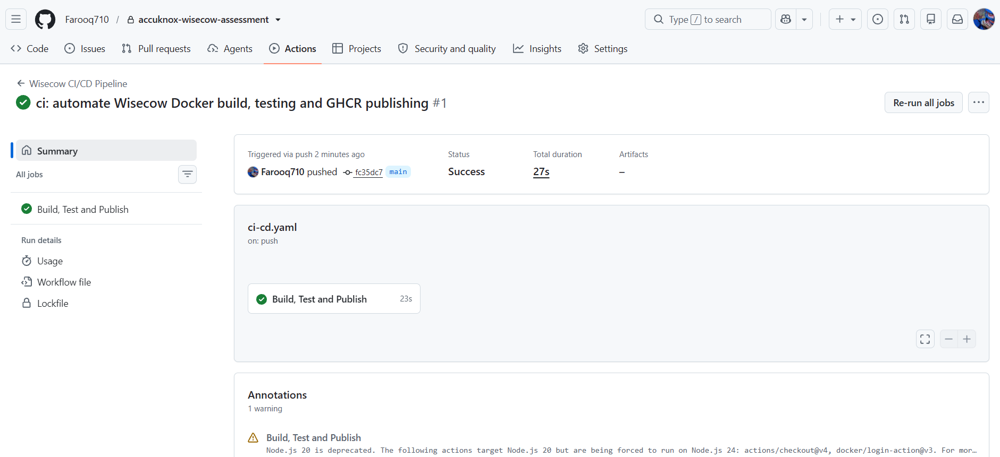

### Private GHCR image

Private container package with latest and commit-SHA tags. Authentication-status lines cropped out.

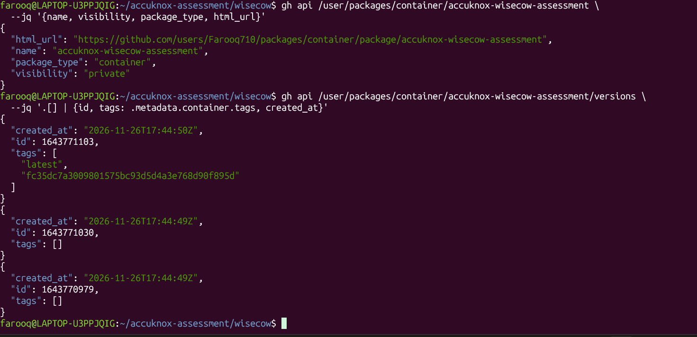

### Registry-backed deployment

Successful Kubernetes rollout with two running pods using the published GHCR commit-specific image.

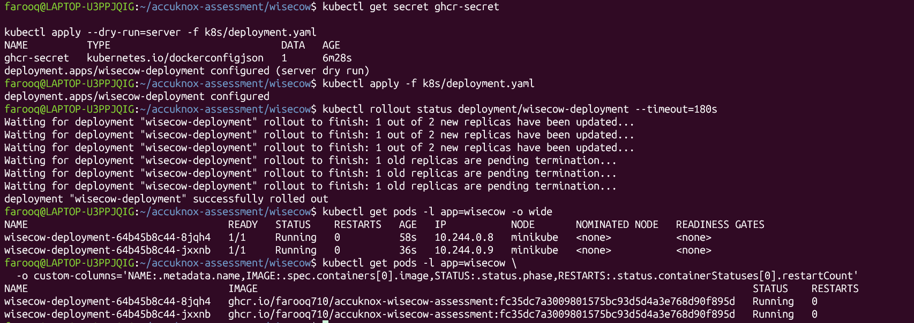

### Ephemeral runner registration

Runner registration succeeded with the ephemeral option; the command retrieves the token dynamically without printing its value.

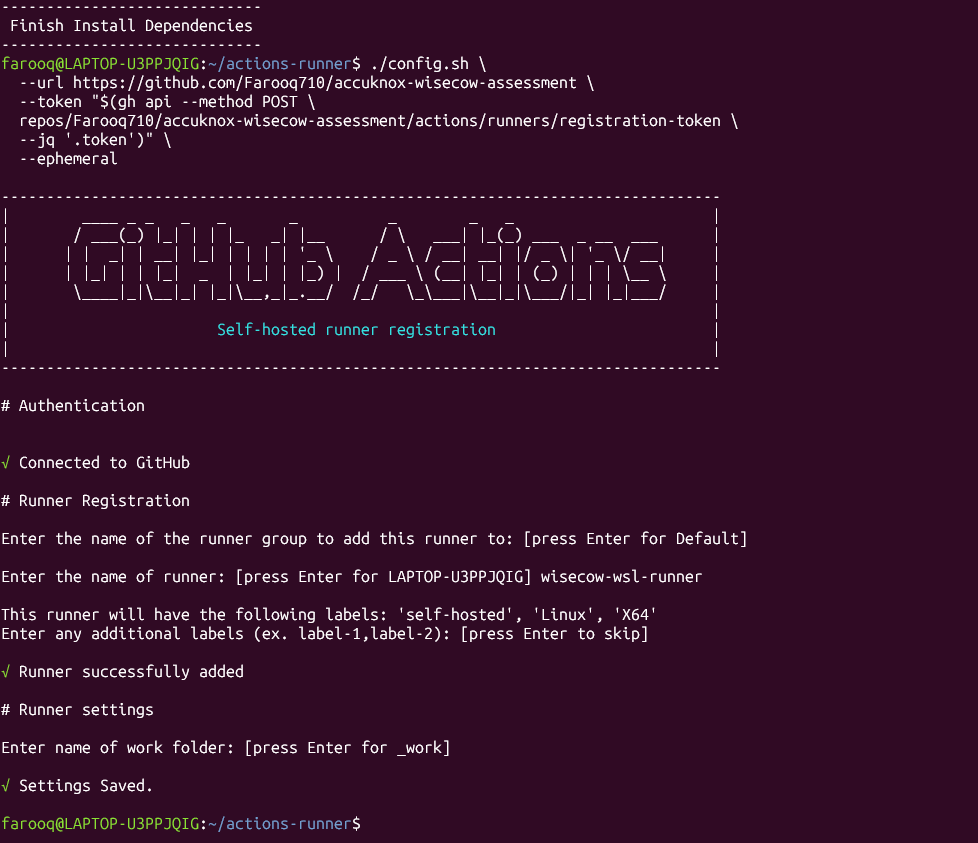

### Automated continuous deployment

GitHub Actions shows both Build, Test and Publish and Deploy to Kubernetes succeeded.

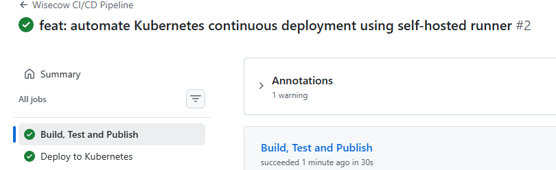

### TLS certificate generation

Certificate metadata, hostname SAN, private-key permissions and Git ignore checks; no key contents shown.

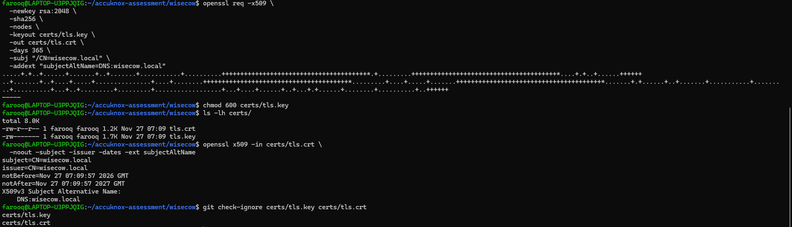

### Kubernetes TLS Secret

Secret type and certificate/key byte counts only; no secret values displayed.

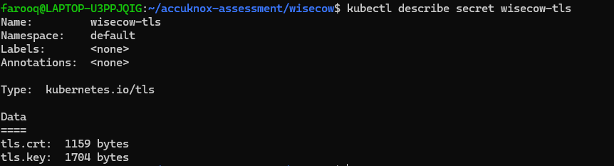

### Traefik Ingress

Ingress routes wisecow.local to the two backend endpoints and references wisecow-tls.

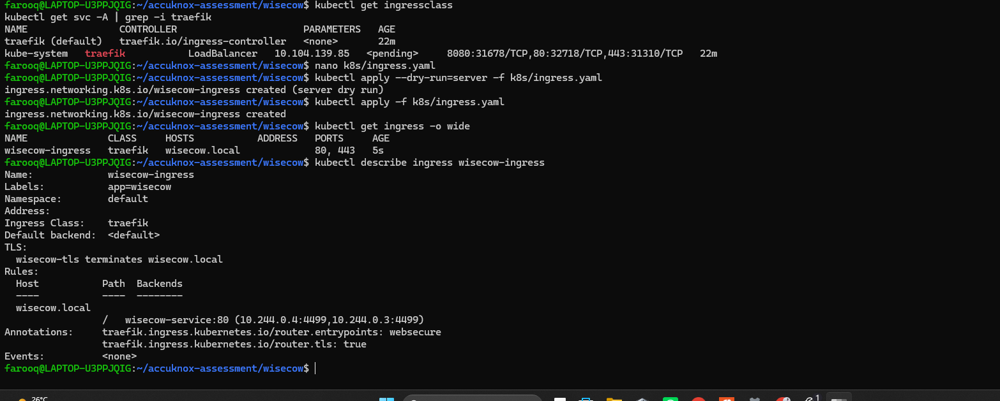

### Verified TLS connection

curl validates the certificate and hostname, negotiates TLS 1.3 and receives HTTP/2 200 with the Wisecow response.

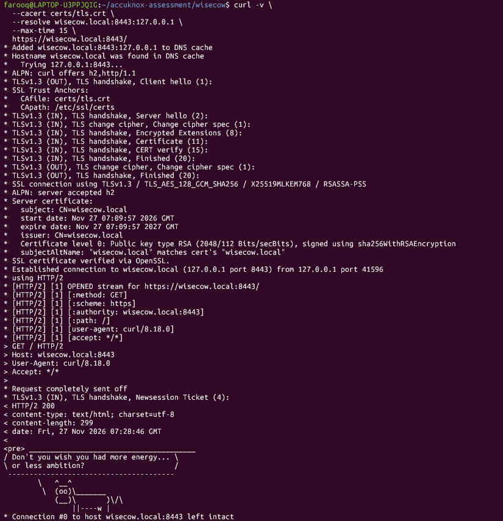

## Problem Statement 2 — Python monitoring scripts

### System health monitoring

CPU 1.8%, memory 17.9%, disk 0.8%, 87 processes; overall status HEALTHY.

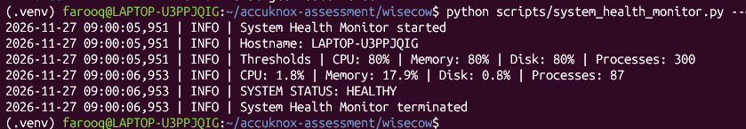

### HTTPS application health check

Application UP with HTTP 200, response time 27.60 ms and TLS verification enabled.

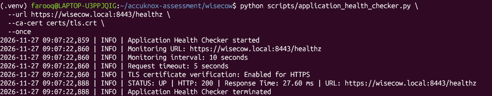

### Continuous monitoring and failure detection

Successful repeated HTTP 200 checks, simulated connection refusal, slow-response warning, TLS verification failure and graceful shutdown.

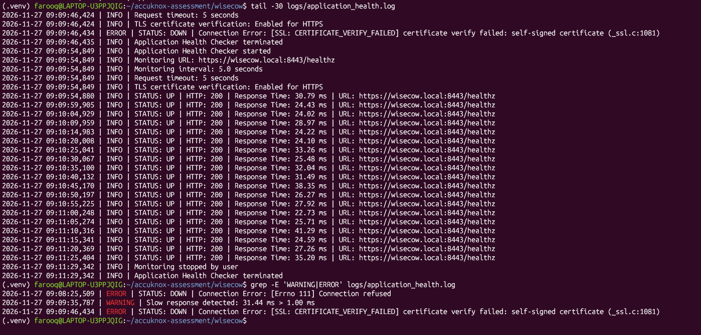

## Evidence scope

The secure-browser result after certificate trust, HTTP-to-HTTPS redirect result, and system threshold-alert result were not included because no matching screenshot was supplied. The TLS verification screenshot independently demonstrates encrypted, certificate-validated communication. The application failure tests are deliberate simulations. The self-hosted runner was used for the demonstrated deployment; the screenshot does not establish its current availability.
